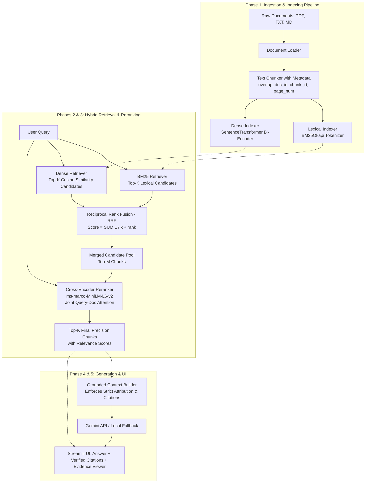

# HybridRAG: System Architecture & Technical Design

## 1. System Overview
**HybridRAG** is a production-grade, modular document question-answering system designed from first principles. Rather than relying on rigid, high-abstraction frameworks (like heavy LangChain/LlamaIndex wrappers), HybridRAG implements the fundamental retrieval and reranking algorithms in transparent, idiomatic Python.

The architecture solves two classic failure modes of naive retrieval:
1. **Keyword Blindness in Dense Search**: Dense embedding models often fail on exact alphanumeric identifiers (part numbers, legal references, acronyms, or specific chemical formulas).
2. **Semantic Ignorance in Lexical Search**: Lexical search (TF-IDF/BM25) cannot match synonyms, paraphrases, or conceptual queries that do not share exact vocabulary.

HybridRAG addresses both by combining **BM25 Lexical Retrieval** and **Dense Vector Retrieval** via **Reciprocal Rank Fusion (RRF)**, followed by a **Cross-Encoder Reranking** stage for maximum precision.

---

## 2. End-to-End Architectural Flow



---

## 3. Data Flow Specification

### 3.1 Document Ingestion Flow
1. **Loading**: Raw files (`.pdf`, `.txt`, `.md`) are read from disk.
   - For PDFs, `PyMuPDF` extracts text per page preserving `page_number`.
   - For TXT/Markdown, content is extracted preserving section headings.
2. **Chunking**: Text is partitioned into windows of $N$ characters (e.g., 500) with an overlap of $M$ characters (e.g., 100).
   - Each chunk is stored as a typed data object (`Chunk`) containing:
     - `chunk_id`: Unique identifier (e.g., `doc1_chunk003`)
     - `document_name`: Source file name
     - `page_number`: Optional page index (1-based for PDF)
     - `text`: Raw text slice
3. **Dual Index Construction**:
   - **Lexical Index**: Chunks are tokenized (lowercased, punctuation-stripped) and indexed into a `BM25Okapi` inverted index.
   - **Dense Index**: Chunks are encoded via a lightweight bi-encoder (`all-MiniLM-L6-v2`) into $d$-dimensional dense vectors (384-d float32) and stored in a NumPy array.

### 3.2 Query & Retrieval Flow
1. **Parallel Candidate Generation**:
   - The user query $Q$ is tokenized and scored across all documents using BM25, returning top $K_1$ candidates.
   - The user query $Q$ is encoded into an embedding vector $\mathbf{v}_q$. Cosine similarity is computed against all document vectors via NumPy matrix multiplication, returning top $K_2$ candidates.
2. **Rank Fusion (RRF)**:
   - Candidate lists are merged using Reciprocal Rank Fusion:
     $$\text{RRF\_Score}(d) = \sum_{m \in \{\text{BM25}, \text{Dense}\}} \frac{1}{k + \text{rank}_m(d)}$$
     where $k$ is a smoothing constant (standard default is $k=60$).
   - The top $M$ unique chunks (e.g., $M = 10$) are selected as candidates for reranking.
3. **Cross-Encoder Precision Reranking**:
   - The query and each candidate passage are concatenated and evaluated jointly: $[Q; \text{Chunk}_i]$.
   - The Cross-Encoder outputs a real-valued logit representing the exact semantic relevance of the passage to the query.
   - The candidates are sorted by reranker score, and the top $P$ (e.g., $P = 3 \text{ to } 5$) are preserved as final grounding context.
4. **Grounded Generation (Optional)**:
   - If a Gemini API key is configured, a strict prompt instructs the model to synthesize an answer using *only* the retrieved chunks, requiring explicit citation anchors (e.g., `[DocName, Page X]`).
   - If no API key is provided, the application gracefully operates in **Evidence Viewer Mode**, displaying the top retrieved chunks, their scores, and source citations directly.

---

## 4. Module Boundaries & Responsibilities

| Module Path | Primary Class / Function | Responsibility | External Dependencies |
| :--- | :--- | :--- | :--- |
| `src/hybrid_rag/loader.py` | `DocumentLoader` | Loads `.pdf`, `.txt`, `.md` into standard document representations. | `pymupdf` |
| `src/hybrid_rag/chunker.py` | `TextChunker`, `Chunk` | Splits text into overlapping chunks with persistent metadata. | None (standard library) |
| `src/hybrid_rag/retrieval/bm25.py` | `BM25Retriever` | Tokenizes corpus, builds BM25 index, returns top lexical candidates. | `rank-bm25` |
| `src/hybrid_rag/retrieval/dense.py` | `DenseRetriever` | Computes chunk embeddings, performs cosine similarity searches. | `sentence-transformers`, `numpy` |
| `src/hybrid_rag/retrieval/fusion.py` | `reciprocal_rank_fusion` | Merges rank lists from lexical and dense retrievers via RRF formula. | None (pure Python / math) |
| `src/hybrid_rag/reranker.py` | `CrossEncoderReranker` | Performs joint query-passage scoring via Cross-Encoder model. | `sentence-transformers` |
| `src/hybrid_rag/generator.py` | `GeminiGenerator` | Constructs grounded prompt, calls Gemini API, handles fallback. | `google-genai` |
| `src/hybrid_rag/pipeline.py` | `HybridRAGPipeline` | High-level orchestrator coordinating indexing, retrieval, rerank, and answer generation. | All internal modules |
| `src/hybrid_rag/ui/app.py` | Streamlit Entry Point | Interactive interface: file upload, query box, inspection tabs, metric displays. | `streamlit` |

---

## 5. Architectural Trade-offs & Engineering Decisions

### 5.1 Bi-Encoder vs. Cross-Encoder
- **Bi-Encoder (Dense Retriever)**:
  - Encodes query and documents separately: $\text{score} = \langle f(Q), f(D) \rangle$.
  - *Advantage*: Document embeddings can be precomputed and stored offline. Retrieval latency is $O(N \cdot d)$ vector dot products, which takes milliseconds.
  - *Limitation*: Because query and document tokens do not interact in the self-attention layers, subtle nuances or cross-sentence dependencies are missed.
- **Cross-Encoder (Reranker)**:
  - Encodes query and document together: $\text{score} = g([Q; D])$.
  - *Advantage*: Full cross-attention between every query token and every document token, yielding state-of-the-art ranking precision.
  - *Limitation*: Cannot be precomputed; requires a forward pass of a transformer model for every $(Q, D)$ pair at query time.
- **Architectural Solution**: Two-stage retrieval. Bi-Encoder and BM25 cast a wide net across thousands of chunks to find top 20 candidates. Cross-Encoder reranks only those 20 candidates, keeping latency under ~150ms on CPU.

### 5.2 Reciprocal Rank Fusion (RRF) vs. Score Normalization
- *Alternative*: Min-Max normalizing BM25 scores and Cosine similarities, then taking a weighted sum: $\alpha S_{\text{bm25}} + (1-\alpha) S_{\text{dense}}$.
- *Why RRF was chosen*:
  - BM25 scores are unbounded $[0, \infty)$ and scale with document length and corpus size.
  - Cosine similarities lie in $[-1, 1]$ or $[0, 1]$ with an entirely different distribution.
  - Simple linear combination requires extensive hyperparameter tuning for $\alpha$ and is fragile to outliers.
  - RRF operates solely on *ordinal ranks*, making it completely scale-invariant and robust across heterogeneous corpora without needing per-dataset calibration.

### 5.3 In-Memory NumPy Vector Store vs. Heavy Vector DB
- For an educational and interview-focused project indexing tens to thousands of chunks, an external vector database (Milvus, Pinecone, Qdrant, Chroma) introduces network complexity, external service dependencies, and debugging friction.
- A normalized NumPy matrix with dot-product cosine similarity $\mathbf{Q} \cdot \mathbf{M}^T$ is mathematically identical to vector DB flat indexing, executes in single-digit milliseconds for $< 100,000$ chunks, and allows students to explain the exact linear algebra behind retrieval.

---

## 6. Document Ingestion Layer (Phase 1 Implementation)

### 6.1 Schema & Data Flow
The document ingestion layer converts raw files into structured, typed data objects without executing file contents or requiring an external database:
1. `DocumentLoader.load(file_path)` parses `.pdf`, `.txt`, and `.md` files into a `Document` composed of one or more `DocumentPage` instances.
2. `TextChunker.chunk_document(document)` splits the pages into discrete, overlapping `Chunk` dataclasses while maintaining 1-based page numbers.

### 6.2 Chunk Size & Overlap Trade-offs
The choice of `chunk_size` and `chunk_overlap` is a fundamental engineering trade-off in RAG systems:
- **Small Chunks (e.g. 100–300 chars)**:
  - *Pros*: Precise semantic vector embeddings; pinpoint retrieval accuracy; less noisy context sent to LLM.
  - *Cons*: Misses broader contextual context; fragmented concepts; higher total chunk count increases index memory.
- **Large Chunks (e.g. 1,000–2,000 chars)**:
  - *Pros*: Preserves long-range reasoning, multi-step arguments, and full paragraphs.
  - *Cons*: Vector representations become diluted averages ("semantic wash"); LLM context fills up quickly; higher risk of irrelevant filler text in retrieval.
- **Chunk Overlap (e.g. 10%–25% of chunk size)**:
  - *Purpose*: Helps preserve local context and semantic continuity across boundaries, reducing fragmentation between adjacent slices.
  - *Important Limitation*: While overlap mitigates the risk of splitting adjacent words or short phrases, fixed-character sliding windows *do not guarantee* that every complete sentence will appear unbroken in a single chunk. Long sentences or complex clauses can still span across boundaries unless explicit sentence-aware or semantic segmentation is applied.

### 6.3 Page Boundary Isolation for Strict Provenance
A common flaw in naive RAG pipelines is splitting raw text across page boundaries without tracking where one page ended and the next began. This leads to broken or misleading citations (e.g., claiming a fact is on Page 2 when half of the sentence was on Page 3).
In HybridRAG:
- Paginated documents (PDFs) are chunked on a **per-page basis**.
- Each generated `Chunk` has an explicit 1-based `page_number` matching the physical PDF page.
- This guarantees unambiguous evidence attribution in user interfaces and interview explanations.

### 6.4 Python Usage Example
```python
from pathlib import Path
from hybrid_rag import DocumentLoader, TextChunker

# 1. Load document with automatic format detection
doc = DocumentLoader.load("sample_docs/apollo_space_missions.md")
print(f"Loaded '{doc.filename}' ({doc.file_type}) with {doc.total_pages} page(s).")

# 2. Chunk with 500-char window and 100-char overlap
chunker = TextChunker(chunk_size=500, chunk_overlap=100)
chunks = chunker.chunk_document(doc)

print(f"Generated {len(chunks)} chunks.")
first_chunk = chunks[0]
print(f"Chunk ID: {first_chunk.chunk_id}")
print(f"Offsets: [{first_chunk.char_start} : {first_chunk.char_end}]")
print(f"Page: {first_chunk.page_number}")
print(f"Text Preview:\n{first_chunk.text[:120]}...")
```

Expected Output:
```text
Loaded 'apollo_space_missions.md' (md) with 1 page(s).
Generated 6 chunks.
Chunk ID: apollo_space_missions_937f609c_c0
Offsets: [0 : 500]
Page: None
Text Preview:
# Apollo Lunar Exploration Program

## Overview of the Program
The Apollo program was an American human spaceflight init...
```


### 6.5 Limitations & Edge Cases Handled
- **Scanned / Image PDFs**: PyMuPDF extracts programmatic text streams. Scanned image-only PDFs without OCR text layers yield zero text and trigger `EmptyDocumentError`.
- **Corrupt / Malformed Files**: Corrupt streams trigger `DocumentParsingError` with descriptive context.
- **Encoding Quirks**: Plain text loading defaults to UTF-8 with automatic fallback to Latin-1.
- **Validation**: Strict checks ensure `chunk_size > 0`, `chunk_overlap >= 0`, and `chunk_overlap < chunk_size`.

---

## 7. Dual Retrieval & Reciprocal Rank Fusion (Phase 2 Implementation)

### 7.1 Component Breakdown & Data Flow
Phase 2 establishes parallel candidate generation and scale-invariant rank aggregation:

1. **BM25Retriever (`src/hybrid_rag/retrieval/bm25.py`)**:
   - Tokenizes input texts and queries with a unified regex tokenizer (`\w+`, lowercased).
   - Ingests `Chunk` instances into an in-memory `BM25Okapi` inverted index.
   - Computes query scores and returns ranked `RetrievalResult` objects.
   - Employs token-presence filtering to eliminate chunks that share zero query terms while gracefully handling degenerate negative IDF values on small collections.

2. **DenseRetriever (`src/hybrid_rag/retrieval/dense.py`)**:
   - Uses `sentence-transformers/all-MiniLM-L6-v2` (384-dimensional dense embeddings).
   - **Single-Pass In-Memory Indexing**: All chunks are encoded once at index time into a matrix $\mathbf{E} \in \mathbb{R}^{N \times 384}$, which is unit-normalized along rows: $\mathbf{E}_{\text{norm}} = \frac{\mathbf{E}}{\|\mathbf{E}\|_2}$.
   - **Vectorized Query Cosine Similarity**: Query text is encoded and normalized to $\mathbf{q}_{\text{norm}} \in \mathbb{R}^{384}$. Cosine similarities for all $N$ chunks are calculated simultaneously via a single BLAS matrix-vector product:
     $$\mathbf{S} = \mathbf{E}_{\text{norm}} \cdot \mathbf{q}_{\text{norm}}$$
   - Detects non-finite vectors (`NaN` / `Inf`) and applies deterministic sorting with $O(N)$ top-K filtering.

3. **Reciprocal Rank Fusion (`src/hybrid_rag/retrieval/fusion.py`)**:
   - Blends ranked candidate lists from BM25 and Dense retrieval into a single deduplicated list of `FusedResult` objects.
   - **Formula**: For candidate chunk $d$:
     $$\text{RRF\_Score}(d) = \sum_{m \in \{\text{BM25}, \text{Dense}\}} \frac{1}{k + \text{rank}_m(d)}$$
     with standard smoothing constant $k=60$.
   - **Scale Invariance**: Because BM25 scores are unbounded $[0, \infty)$ and dense cosine similarities are bounded $[-1, 1]$, raw scores can never be summed directly. RRF relies exclusively on ordinal integer ranks (1, 2, ...), preventing score magnitude domination.
   - **Deterministic Tie-Breaking**: Chunks with identical RRF scores are ordered alphabetically by `chunk_id`.

### 7.2 Python Usage Example (Phase 2)
```python
from hybrid_rag import BM25Retriever, DenseRetriever, DocumentLoader, TextChunker, reciprocal_rank_fusion

# 1. Ingest and chunk sample document
doc = DocumentLoader.load("sample_docs/apollo_space_missions.md")
chunks = TextChunker(chunk_size=500, chunk_overlap=100).chunk_document(doc)

# 2. Build in-memory indexes
bm25 = BM25Retriever(chunks=chunks)
dense = DenseRetriever(chunks=chunks)

# 3. Retrieve and fuse
query = "What rocket was used to launch the Apollo missions?"
bm25_results = bm25.retrieve(query, top_k=3)
dense_results = dense.retrieve(query, top_k=3)
fused_results = reciprocal_rank_fusion(bm25_results, dense_results, k=60, top_k=3)

for item in fused_results:
    print(f"Rank {item.rank} | RRF Score: {item.rrf_score:.6f} | Chunk ID: {item.chunk.chunk_id}")
    print(f"   Provenance: BM25 Rank {item.bm25_rank} | Dense Rank {item.dense_rank}")
```

---

## 8. Cross-Encoder Precision Reranking (Phase 3 Implementation)

### 8.1 Multi-Stage Architecture: "Retrieve-then-Rerank"
In production Information Retrieval (IR) and RAG systems, scaling constraints mandate a multi-stage funnel:

```
[Entire Corpus: N Chunks]
           │
           ▼ Stage 1: Fast Candidate Generation (BM25 + Bi-Encoder Dense Retrieval)
   [Candidate Pool: K Chunks, e.g., K = 6 to 50]
           │
           ▼ Reciprocal Rank Fusion (RRF k=60)
   [Deduplicated Ranked Candidates: K Chunks]
           │
           ▼ Stage 2: Deep Cross-Encoder Reranking (cross-encoder/ms-marco-MiniLM-L6-v2)
   [Final Precision Context: Top-M Chunks, e.g., M = 3 to 5]
           │
           ▼ Stage 3: LLM Answer Synthesis (Gemini API with Citations - Phase 4)
```

#### Theoretical Computational Complexity Trade-off:
- **Bi-Encoder / Dense Indexing**:
  - Corpus encoding occurs **offline** once: $O(N \cdot L_{\text{chunk}}^2)$.
  - Online query-time search is a matrix-vector dot product: $O(N \cdot d)$ where $d=384$. Because dot products over pre-computed vectors are lightweight BLAS operations, dense search over $N$ pre-indexed chunks requires vastly fewer online FLOPs than running full transformer passes at query time.
- **Cross-Encoder**:
  - Encodes the query and passage **jointly**: `[CLS] Query [SEP] Passage [SEP]`.
  - Offline pre-computation of relevance is **impossible** because candidate passages must interact directly with the dynamic query text via self-attention.
  - Inference complexity scales quadratically with concatenated sequence length and linearly with the candidate pool size: $O(K \cdot (L_q + L_d)^2 \cdot L_{\text{layers}})$. Running full cross-attention across an entire corpus of size $N$ for every query is computationally prohibitive.
  - By restricting reranking to a candidate pool $K \ll N$ (e.g., $K=6$ to $20$), deep cross-attention is constrained to a small, tractable subset of candidates. *(Note: Actual wall-clock latency varies based on hardware acceleration, CPU/GPU concurrency, batch size, and sequence length, and must be measured empirically on target deployment hardware rather than assumed.)*

### 8.2 Cross-Encoder Attention Mechanics
- **Bi-Encoder Limitation**: The bi-encoder compresses a chunk into a single 384-dimensional vector. During cosine similarity ($\mathbf{q} \cdot \mathbf{d}$), no token-to-token attention can happen between query words and document words. Nuances such as negation ("not required" vs "required") or specific syntactic modifiers are easily lost during mean pooling.
- **Cross-Encoder Advantage**: Self-attention layers compute all-to-all attention between every token of the query and every token of the candidate chunk simultaneously. The model observes full contextual dependencies and word interactions before predicting relevance.

### 8.3 Important Engineering Caveats
1. **Uncalibrated Logits vs. Probabilities**:
   - The Cross-Encoder outputs raw, real-valued scalar logits $s \in (-\infty, \infty)$ trained with binary cross-entropy on MS MARCO passage ranking.
   - Higher scores indicate stronger predicted relevance, but these values are **not calibrated probabilities**. A score of `3.0` does not mean "300% confident" nor does a difference between `1.0` and `2.0` represent double the likelihood. Reranking relies strictly on ordinal sorting by score descending.
2. **Empirical Validation Requirement**:
   - Applying a pretrained reranker does not automatically guarantee superior answer quality on every domain. Domain mismatch or poor candidate generation can cause the reranker to promote distractors.
   - Any claims of improved retrieval accuracy must be validated quantitatively using information retrieval benchmarks (Recall@k, MRR) as planned for Phase 5.
3. **Deterministic Tie-Breaking & Robustness**:
   - When two candidate passages receive identical relevance logits, tie-breaking falls back deterministically to alphabetical `chunk_id` ordering.
   - Numerical stability checks ensure non-finite values (`NaN`, `Inf`) raise descriptive `ValueError` exceptions immediately rather than corrupting downstream ranking.

### 8.4 Component Breakdown (`src/hybrid_rag/reranker.py` & `schema.py`)
- **`CrossEncoderReranker`**:
  - `model_name_or_path`: Defaults to `cross-encoder/ms-marco-MiniLM-L6-v2`.
  - `model`: Supports dependency-injected test doubles (`FakeCrossEncoder`) for 100% offline, reproducible testing.
  - `_get_model()`: Implements lazy loading so that importing the class does not trigger heavy PyTorch or network overhead.
  - `rerank(query, candidates, top_k)`: Forms `(query, cand.chunk.text)` pairs, computes model predictions in configurable batches, validates numerical stability, sorts deterministically, and slices to `top_k`.
- **`RerankedResult`**:
  - Retains the underlying `Chunk` with full text and page/character offsets.
  - Retains the new `rerank_rank` (1-based) and `reranker_score` (logit).
  - Preserves complete pre-rerank provenance: `rrf_score`, `rrf_rank`, `bm25_rank`, `bm25_score`, `dense_rank`, and `dense_score`.

### 8.5 Python Usage Example (Phase 3)
```python
from hybrid_rag import (
    BM25Retriever,
    CrossEncoderReranker,
    DenseRetriever,
    DocumentLoader,
    TextChunker,
    reciprocal_rank_fusion,
)

# 1. Ingest and chunk documents
doc = DocumentLoader.load("sample_docs/apollo_space_missions.md")
chunks = TextChunker(chunk_size=500, chunk_overlap=100).chunk_document(doc)

# 2. Build first-stage indexes
bm25 = BM25Retriever(chunks=chunks)
dense = DenseRetriever(chunks=chunks)

# 3. Retrieve and fuse candidates (Stage 1)
query = "What rocket was used to launch the Apollo missions?"
bm25_candidates = bm25.retrieve(query, top_k=6)
dense_candidates = dense.retrieve(query, top_k=6)
fused_candidates = reciprocal_rank_fusion(bm25_candidates, dense_candidates, k=60, top_k=6)

# 4. Precision rerank top candidates (Stage 2)
reranker = CrossEncoderReranker()
final_results = reranker.rerank(query=query, candidates=fused_candidates, top_k=3)

for res in final_results:
    print(f"Rerank #{res.rerank_rank} (Score: {res.reranker_score:.4f}) | Pre-Rerank RRF Rank: {res.rrf_rank}")
    print(f"Source: {res.chunk.document_name} | Chunk ID: {res.chunk.chunk_id}")
    print(f"Text: {res.chunk.text[:80]}...\n")
```

