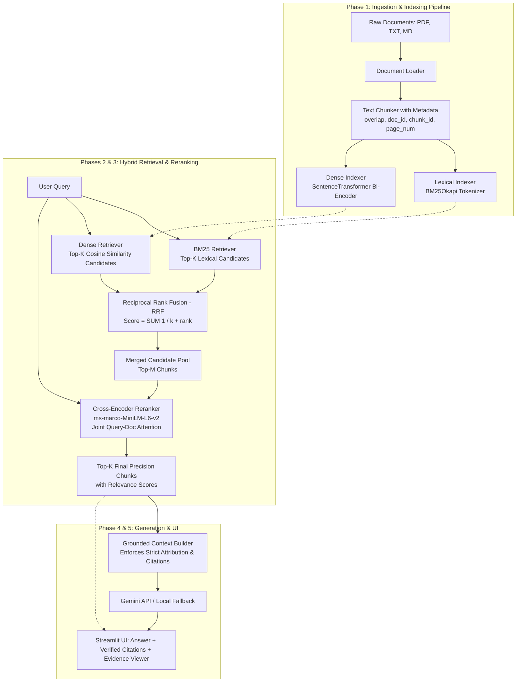

# HybridRAG: System Architecture & Technical Design

## 1. System Overview
**HybridRAG** is a production-grade, modular document question-answering system designed from first principles. Rather than relying on rigid, high-abstraction frameworks (like heavy LangChain/LlamaIndex wrappers), HybridRAG implements the fundamental retrieval and reranking algorithms in transparent, idiomatic Python.

The architecture solves two classic failure modes of naive retrieval:
1. **Keyword Blindness in Dense Search**: Dense embedding models often fail on exact alphanumeric identifiers (part numbers, legal references, acronyms, or specific chemical formulas).
2. **Semantic Ignorance in Lexical Search**: Lexical search (TF-IDF/BM25) cannot match synonyms, paraphrases, or conceptual queries that do not share exact vocabulary.

HybridRAG addresses both by combining **BM25 Lexical Retrieval** and **Dense Vector Retrieval** via **Reciprocal Rank Fusion (RRF)**, followed by a **Cross-Encoder Reranking** stage for maximum precision.

---

## 2. End-to-End Architectural Flow

---

## 3. Data Flow Specification

### 3.1 Document Ingestion Flow
1. **Loading**: Raw files (`.pdf`, `.txt`, `.md`) are read from disk.
   - For PDFs, `PyMuPDF` extracts text per page preserving `page_number`.
   - For TXT/Markdown, content is extracted preserving section headings.
2. **Chunking**: Text is partitioned into windows of $N$ characters (e.g., 500) with an overlap of $M$ characters (e.g., 100).
   - Each chunk is stored as a typed data object (`Chunk`) containing:
     - `chunk_id`: Unique identifier (e.g., `doc1_chunk003`)
     - `document_name`: Source file name
     - `page_number`: Optional page index (1-based for PDF)
     - `text`: Raw text slice
3. **Dual Index Construction**:
   - **Lexical Index**: Chunks are tokenized (lowercased, punctuation-stripped) and indexed into a `BM25Okapi` inverted index.
   - **Dense Index**: Chunks are encoded via a lightweight bi-encoder (`all-MiniLM-L6-v2`) into $d$-dimensional dense vectors (384-d float32) and stored in a NumPy array.

### 3.2 Query & Retrieval Flow
1. **Parallel Candidate Generation**:
   - The user query $Q$ is tokenized and scored across all documents using BM25, returning top $K_1$ candidates.
   - The user query $Q$ is encoded into an embedding vector $\mathbf{v}_q$. Cosine similarity is computed against all document vectors via NumPy matrix multiplication, returning top $K_2$ candidates.
2. **Rank Fusion (RRF)**:
   - Candidate lists are merged using Reciprocal Rank Fusion:
     $$\text{RRF\_Score}(d) = \sum_{m \in \{\text{BM25}, \text{Dense}\}} \frac{1}{k + \text{rank}_m(d)}$$
     where $k$ is a smoothing constant (standard default is $k=60$).
   - The top $M$ unique chunks (e.g., $M = 10$) are selected as candidates for reranking.
3. **Cross-Encoder Precision Reranking**:
   - The query and each candidate passage are concatenated and evaluated jointly: $[Q; \text{Chunk}_i]$.
   - The Cross-Encoder outputs a real-valued logit representing the exact semantic relevance of the passage to the query.
   - The candidates are sorted by reranker score, and the top $P$ (e.g., $P = 3 \text{ to } 5$) are preserved as final grounding context.
4. **Grounded Generation (Optional)**:
   - If a Gemini API key is configured, a strict prompt instructs the model to synthesize an answer using *only* the retrieved chunks, requiring explicit citation anchors (e.g., `[DocName, Page X]`).
   - If no API key is provided, the application gracefully operates in **Evidence Viewer Mode**, displaying the top retrieved chunks, their scores, and source citations directly.

---

## 4. Module Boundaries & Responsibilities

| Module Path | Primary Class / Function | Responsibility | External Dependencies |
| :--- | :--- | :--- | :--- |
| `src/hybrid_rag/loader.py` | `DocumentLoader` | Loads `.pdf`, `.txt`, `.md` into standard document representations. | `pymupdf` |
| `src/hybrid_rag/chunker.py` | `TextChunker`, `Chunk` | Splits text into overlapping chunks with persistent metadata. | None (standard library) |
| `src/hybrid_rag/retrieval/bm25.py` | `BM25Retriever` | Tokenizes corpus, builds BM25 index, returns top lexical candidates. | `rank-bm25` |
| `src/hybrid_rag/retrieval/dense.py` | `DenseRetriever` | Computes chunk embeddings, performs cosine similarity searches. | `sentence-transformers`, `numpy` |
| `src/hybrid_rag/retrieval/fusion.py` | `reciprocal_rank_fusion` | Merges rank lists from lexical and dense retrievers via RRF formula. | None (pure Python / math) |
| `src/hybrid_rag/reranker.py` | `CrossEncoderReranker` | Performs joint query-passage scoring via Cross-Encoder model. | `sentence-transformers` |
| `src/hybrid_rag/generator.py` | `GeminiGenerator` | Constructs grounded prompt, calls Gemini API, handles fallback. | `google-genai` |
| `src/hybrid_rag/pipeline.py` | `HybridRAGPipeline` | High-level orchestrator coordinating indexing, retrieval, rerank, and answer generation. | All internal modules |
| `src/hybrid_rag/ui/app.py` | Streamlit Entry Point | Interactive interface: file upload, query box, inspection tabs, metric displays. | `streamlit` |

---

## 5. Architectural Trade-offs & Engineering Decisions

### 5.1 Bi-Encoder vs. Cross-Encoder
- **Bi-Encoder (Dense Retriever)**:
  - Encodes query and documents separately: $\text{score} = \langle f(Q), f(D) \rangle$.
  - *Advantage*: Document embeddings can be precomputed and stored offline. Retrieval latency is $O(N \cdot d)$ vector dot products, which takes milliseconds.
  - *Limitation*: Because query and document tokens do not interact in the self-attention layers, subtle nuances or cross-sentence dependencies are missed.
- **Cross-Encoder (Reranker)**:
  - Encodes query and document together: $\text{score} = g([Q; D])$.
  - *Advantage*: Full cross-attention between every query token and every document token, yielding state-of-the-art ranking precision.
  - *Limitation*: Cannot be precomputed; requires a forward pass of a transformer model for every $(Q, D)$ pair at query time.
- **Architectural Solution**: Two-stage retrieval. Bi-Encoder and BM25 cast a wide net across thousands of chunks to find top 20 candidates. Cross-Encoder reranks only those 20 candidates, keeping latency under ~150ms on CPU.

### 5.2 Reciprocal Rank Fusion (RRF) vs. Score Normalization
- *Alternative*: Min-Max normalizing BM25 scores and Cosine similarities, then taking a weighted sum: $\alpha S_{\text{bm25}} + (1-\alpha) S_{\text{dense}}$.
- *Why RRF was chosen*:
  - BM25 scores are unbounded $[0, \infty)$ and scale with document length and corpus size.
  - Cosine similarities lie in $[-1, 1]$ or $[0, 1]$ with an entirely different distribution.
  - Simple linear combination requires extensive hyperparameter tuning for $\alpha$ and is fragile to outliers.
  - RRF operates solely on *ordinal ranks*, making it completely scale-invariant and robust across heterogeneous corpora without needing per-dataset calibration.

### 5.3 In-Memory NumPy Vector Store vs. Heavy Vector DB
- For an educational and interview-focused project indexing tens to thousands of chunks, an external vector database (Milvus, Pinecone, Qdrant, Chroma) introduces network complexity, external service dependencies, and debugging friction.
- A normalized NumPy matrix with dot-product cosine similarity $\mathbf{Q} \cdot \mathbf{M}^T$ is mathematically identical to vector DB flat indexing, executes in single-digit milliseconds for $< 100,000$ chunks, and allows students to explain the exact linear algebra behind retrieval.
